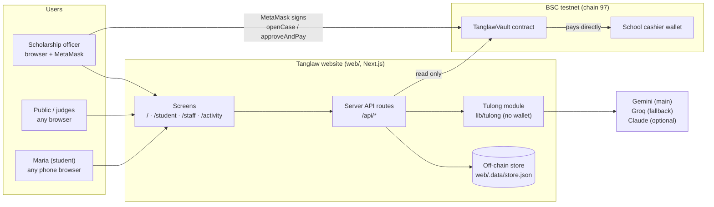
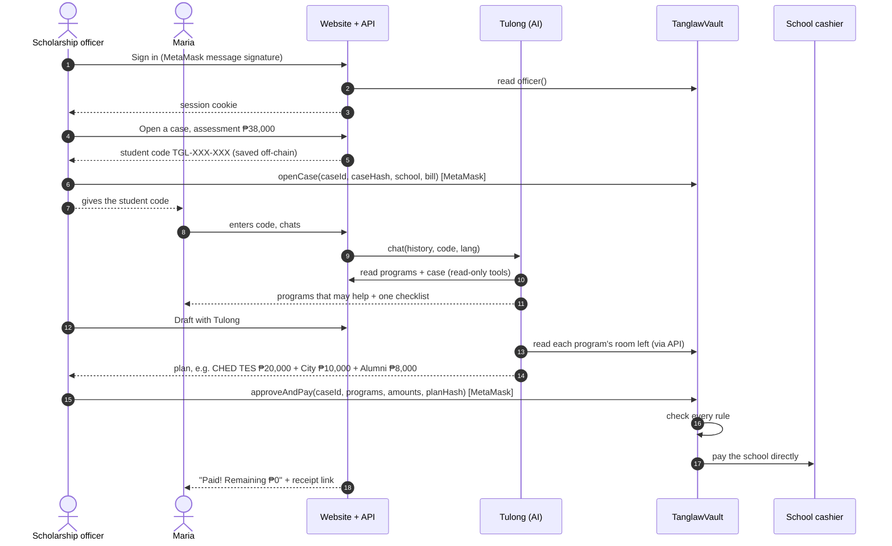
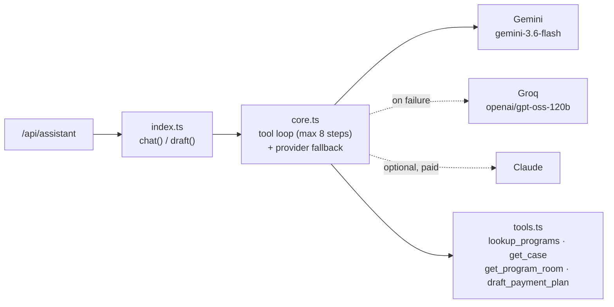

# Tanglaw architecture

How the system is put together: the parts, who uses what, how a request flows, and where each piece of data lives. The build spec is `MIGRATION.md`; this file explains the result.

## 1. The big picture

One website (`web/`, Next.js) plus one smart contract (`contracts/`, Solidity on BSC testnet). The AI (Tulong) runs inside the website's server part and has no wallet.



Key rule: **only the scholarship officer's wallet can move money**, and only through the contract, which checks every rule. The website and Tulong can read the chain but can't write to it.

## 2. Users and screens

| User | Page | Sign-in | Wallet | Can do |
|---|---|---|---|---|
| Everyone | `/` | none | no | Choose a role |
| Student (Maria) | `/student` → `/student/chat` | Case code `TGL-XXX-XXX`, kept in the phone's browser | no | Chat with Tulong, see programs + one checklist, follow **only her own case**, choose Tulong's reply language (⚙: Taglish, English, Filipino) |
| Scholarship officer | `/staff` | Signs a free one-time message in MetaMask; server checks the wallet is the contract's `officer`; 8-hour cookie | yes | Open cases (types the assessment), give the student code, ask Tulong for a plan, edit amounts, sign payments |
| Public | `/activity` | none | no | See every payment and every refused payment (with the contract's reason), program budgets left, BscScan proof. No names |
| Anyone with the link | `/receipt/<tx>` | none | no | One payment's receipt, printable, with a "plan matches the blockchain" check run in the browser |

All buttons and labels are English. Only Tulong's replies follow the student's language setting. Old `/family` links redirect to `/student` (`web/next.config.ts`).

## 3. The main flow (Maria's story)



If a plan breaks a rule (for example raising the Alumni line to ₱15,000 so the total is ₱45,000, more than the ₱38,000 assessment), the contract **reverts** with `OverBill`: nothing is paid, and the screen shows the contract's error. That is the double-funding guard.

## 4. The smart contract (`contracts/src/TanglawVault.sol`)

Holds the scholarship funds (test BNB) and pays schools. Demo rate: ₱1 = 1e11 wei.

| Function | Who | What |
|---|---|---|
| `openCase(caseId, caseHash, school, bill)` | officer | New case with a random ID. The `bill` is the tuition assessment. School must be allowlisted (`isSchool`) |
| `approveAndPay(caseId, programIds, amounts, planHash)` | officer | Checks every line, then pays the case's school in one transfer |
| `setProgram`, `setSchool`, `setOfficer`, `setPaused` | owner (admin) | Settings |
| `remaining(caseId)`, `programRoom(caseId, id)` | anyone | Read-only helpers |

Checks in `approveAndPay`, in order: `NotOfficer`, `Paused`, `CaseNotFound`, `BadArrays`, then per line `InactiveProgram`, `ZeroAmount`, `OverProgramCap` (per-case cap), `OverBudget` (program budget), `OverBill` (never more than the assessment). `openCase` refuses an unlisted school with `UnknownSchool`. Payee is always the case's school, so no plan can send money anywhere else.

Events: `CaseOpened`, `PlanApproved` (with `planHash`), `Paid` (one per line), plus settings events (`ProgramSet`, `SchoolSet`, `OfficerSet`, `PausedSet`). The public page is built from these.

Simulated program rules for the demo: CHED TES cap ₱20,000, City Scholarship ₱10,000, Alumni Grant ₱15,000 per student per term; budget ₱500,000 each. Priority order: TES → City → Alumni.

## 5. The website (`web/`)

```
web/
├── app/
│   ├── page.tsx                 Home (role picker)
│   ├── student/page.tsx         Case code entry
│   ├── student/chat/page.tsx    Maria's chat, case status, settings
│   ├── staff/page.tsx           MetaMask sign-in gate
│   ├── staff/Dashboard.tsx      Cases, plan, sign panel, open case, student code
│   ├── activity/page.tsx        Public record
│   ├── receipt/[tx]/page.tsx    Public receipt + plan check
│   └── api/                     Server routes (below)
├── lib/
│   ├── rules.ts                 Program rules table + checklist (the only source of rules)
│   ├── chain.ts                 Contract ABI, simulation, error messages
│   ├── plan.ts                  Plan type, canonical JSON, planHash, validation
│   ├── peso.ts                  ₱ <-> wei
│   ├── student.ts               Student code + language saved in the browser
│   ├── server/auth.ts           Staff sign-in: nonces, signed cookie
│   ├── server/store.ts          Off-chain JSON store
│   ├── server/indexer.ts        Reads contract state; events from tx receipts (+ log scan if the RPC allows)
│   ├── server/config.ts         Vault address + deploy block, school label
│   └── tulong/                  The AI module (below)
└── components/                  Header, icons
```

### API routes

| Route | Who | Does |
|---|---|---|
| `GET /api/chain` | public | Snapshot: programs, cases (no names), payments |
| `GET /api/student/case?code=` | student | Only that case: assessment, covered, remaining, payments. No case ID, salt or memo |
| `POST /api/assistant` `mode: chat` | student (needs a valid code) | Tulong chat in the chosen language |
| `POST /api/assistant` `mode: draft` | staff | Tulong drafts a payment plan |
| `GET /api/staff/nonce`, `POST /api/staff/login`, `POST /api/staff/logout`, `GET /api/staff/me` | staff | Sign-in |
| `POST /api/cases`, `GET /api/cases` | staff | Save case salt + memo, create student code; list codes |
| `GET /api/plans?caseId=` / `?hash=` / `POST` | staff / public by hash | Stored plans |
| `POST /api/tx` | public (only chain-confirmed data is saved) | After a vault tx is mined: reads its receipt and saves the vault's events. For a reverted `approveAndPay`: decodes the request from the tx input and gets the contract's error by replaying the call (free RPCs refuse `eth_getLogs`, and refusals leave no event) |

Staff-only routes return 401 without the sign-in cookie.

## 6. Tulong, the AI (`web/lib/tulong/`)

The app calls only two functions: `chat(history, code, lang)` and `draft(caseId)`.



- **Read-only tools** plus one output tool (`draft_payment_plan`). No wallet, no key, no tool that writes to the chain or changes the assessment.
- **Fallback:** on a rate limit, timeout, outage, refusal, malformed reply, step cap, or a draft that fails checks twice, the whole request restarts on the next provider. Order set by `TULONG_PROVIDERS`.
- **Validation:** every draft is checked in code (`lib/plan.ts`) before anyone sees it, including a denylist for names, academic-record words and student-number patterns.
- **Prompt injection:** text in a case memo is treated as document text, not an order. Tulong reports it as a warning; the plan can still only pay the school.

## 7. Where data lives

| Data | Where | Public? |
|---|---|---|
| Case ID (random), `caseHash`, assessment, school, payments, program budgets | Blockchain | Yes |
| `planHash` (fingerprint of the approved plan) | Blockchain | Yes |
| Case salt, memo, student code, Tulong's drafts, plans by hash | `web/.data/store.json` (gitignored) | No |
| Copies of `CaseOpened` / `Paid` events and refused `approveAndPay` requests, decoded from the chain | `web/.data/store.json` | The same data is public on-chain |
| Maria's chat history, student code, language | Maria's browser (localStorage, `tanglaw.student.*`) | No |
| Staff session | Signed cookie in the officer's browser | No |
| API keys, deployer key | `.env` on the owner's laptop (gitignored) | No |

`caseHash = keccak256(salt ‖ record)`. The salt stays off-chain, so nobody can guess what the hash stands for. No names, student numbers or grades go on-chain or into the AI plan.

## 8. Security boundaries

- Only the registered officer wallet can open cases or pay; the contract enforces it, not the website.
- Money can only go to the case's allowlisted school (no ghost payees).
- All programs together can never pay more than the assessment (no double-funding).
- Tulong can't sign, can't hold funds, and can't change the assessment.
- The website never sees a private key. MetaMask signs; the server only verifies signatures.
- `web/next.config.ts` reads the root `.env` and exports only allowlisted settings to the web process environment. The allowlist excludes `DEPLOYER_PRIVATE_KEY`.
- Testnet only (chain 97). No real money.

## 9. Running it

| Where | Now | Later |
|---|---|---|
| Website | `cd web && npm run dev` on the laptop → `http://localhost:3000`, phones on the same Wi-Fi via the laptop's IP | Vercel (needs a small database instead of the JSON file) |
| Contract | `forge script contracts/script/Deploy.s.sol:Deploy --root contracts --rpc-url bsc_testnet --broadcast` from the repo root, with `SCHOOL_ADDRESS` and `OFFICER_ADDRESS` set in `.env` | Campus vault deployed Nov 13 at `0x936622Ab9C643C865B312Ad8F5C24b3835c1c84c`, source verified on BscScan. The earlier hospital-themed vault `0xeC24…060D` is retired |
| AI | Free tiers: Gemini + Groq keys in `.env` | Same |

Web settings: `SCHOOL_LABEL` sets the school's display name (default "State University · Cashier (demo)").

Details: `web/README.md`, `contracts/README.md`, `MIGRATION.md` §0.
