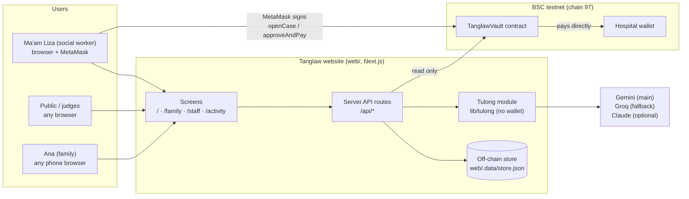
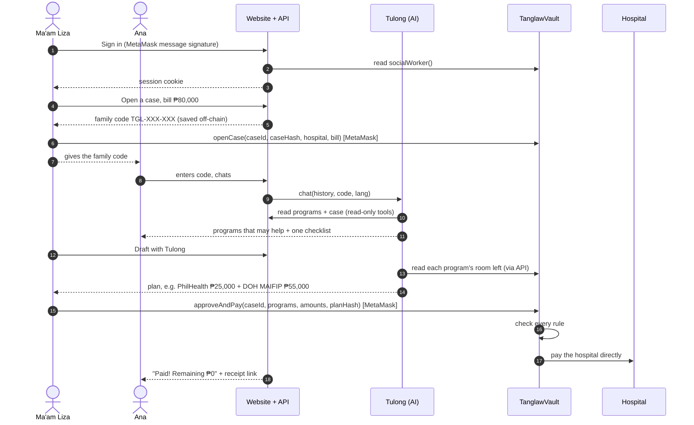
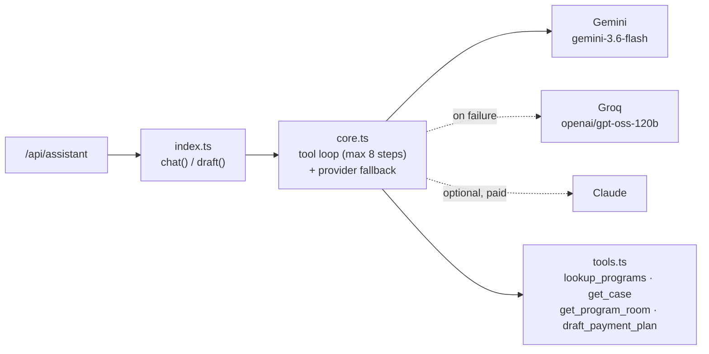

# Tanglaw architecture

How the system is put together: the parts, who uses what, how a request flows, and where each piece of data lives. The build spec is `MIGRATION.md`; this file explains the result.

## 1. The big picture

One website (`web/`, Next.js) plus one smart contract (`contracts/`, Solidity on BSC testnet). The AI (Tulong) runs inside the website's server part and has no wallet.



Key rule: **only Ma'am Liza's wallet can move money**, and only through the contract, which checks every rule. The website and Tulong can read the chain but can't write to it.

## 2. Users and screens

| User | Page | Sign-in | Wallet | Can do |
|---|---|---|---|---|
| Everyone | `/` | none | no | Choose a role |
| Family (Ana) | `/family` → `/family/chat` | Case code `TGL-XXX-XXX`, kept in the phone's browser | no | Chat with Tulong, see programs + one checklist, follow **only her own case**, choose Tulong's reply language (⚙: Taglish, English, Filipino) |
| Social worker (Ma'am Liza) | `/staff` | Signs a free one-time message in MetaMask; server checks the wallet is the contract's `socialWorker`; 8-hour cookie | yes | Open cases (types the bill), give the family code, ask Tulong for a plan, edit amounts, sign payments |
| Public | `/activity` | none | no | See every payment, program budgets left, BscScan proof. No names |

All buttons and labels are English. Only Tulong's replies follow the family's language setting.

## 3. The main flow (Ana's story)



If a plan breaks a rule (for example ₱200,000 from PhilHealth), the contract **reverts**: nothing is paid, and the screen shows the contract's error.

## 4. The smart contract (`contracts/src/TanglawVault.sol`)

Holds the aid funds (test BNB) and pays hospitals. Demo rate: ₱1 = 1e11 wei.

| Function | Who | What |
|---|---|---|
| `openCase(caseId, caseHash, hospital, bill)` | social worker | New case with a random ID. Hospital must be allowlisted |
| `approveAndPay(caseId, programIds, amounts, planHash)` | social worker | Checks every line, then pays the case's hospital in one transfer |
| `setProgram`, `setHospital`, `setSocialWorker`, `setPaused` | owner (admin) | Settings |
| `remaining(caseId)`, `programRoom(caseId, id)` | anyone | Read-only helpers |

Checks in `approveAndPay`, in order: `NotSocialWorker`, `Paused`, `CaseNotFound`, `BadArrays`, then per line `InactiveProgram`, `ZeroAmount`, `OverProgramCap` (per-case cap), `OverBudget` (program budget), `OverBill` (never more than the bill). Payee is always the case's hospital, so no plan can send money anywhere else.

Events: `CaseOpened`, `PlanApproved` (with `planHash`), `Paid` (one per line), plus settings events. The public page is built from these.

Simulated program rules for the demo: PhilHealth cap ₱25,000, DOH MAIFIP ₱60,000, PCSO IMAP ₱20,000 per case; budget ₱500,000 each.

## 5. The website (`web/`)

```
web/
├── app/
│   ├── page.tsx                 Home (role picker)
│   ├── family/page.tsx          Case code entry
│   ├── family/chat/page.tsx     Ana's chat, case status, settings
│   ├── staff/page.tsx           MetaMask sign-in gate
│   ├── staff/Dashboard.tsx      Cases, plan, sign panel, open case, family code
│   ├── activity/page.tsx        Public record
│   └── api/                     Server routes (below)
├── lib/
│   ├── rules.ts                 Program rules table + checklist (the only source of rules)
│   ├── chain.ts                 Contract ABI, simulation, error messages
│   ├── plan.ts                  Plan type, canonical JSON, planHash, validation
│   ├── peso.ts                  ₱ <-> wei
│   ├── family.ts                Family code + language saved in the browser
│   ├── server/auth.ts           Staff sign-in: nonces, signed cookie
│   ├── server/store.ts          Off-chain JSON store
│   ├── server/indexer.ts        Reads contract events and state
│   ├── server/config.ts         Vault address + deploy block
│   └── tulong/                  The AI module (below)
└── components/                  Header, icons
```

### API routes

| Route | Who | Does |
|---|---|---|
| `GET /api/chain` | public | Snapshot: programs, cases (no names), payments |
| `GET /api/family/case?code=` | family | Only that case: bill, covered, remaining, payments. No case ID, salt or memo |
| `POST /api/assistant` `mode: chat` | family (needs a valid code) | Tulong chat in the chosen language |
| `POST /api/assistant` `mode: draft` | staff | Tulong drafts a payment plan |
| `GET /api/staff/nonce`, `POST /api/staff/login`, `POST /api/staff/logout`, `GET /api/staff/me` | staff | Sign-in |
| `POST /api/cases`, `GET /api/cases` | staff | Save case salt + memo, create family code; list codes |
| `GET /api/plans?caseId=` / `?hash=` / `POST` | staff / public by hash | Stored plans |

Staff-only routes return 401 without the sign-in cookie.

## 6. Tulong, the AI (`web/lib/tulong/`)

The app calls only two functions: `chat(history, code, lang)` and `draft(caseId)`.



- **Read-only tools** plus one output tool (`draft_payment_plan`). No wallet, no key, no tool that writes to the chain or changes the bill.
- **Fallback:** on a rate limit, timeout, outage, refusal, malformed reply, step cap, or a draft that fails checks twice, the whole request restarts on the next provider. Order set by `TULONG_PROVIDERS`.
- **Validation:** every draft is checked in code (`lib/plan.ts`) before anyone sees it.
- **Prompt injection:** text in a case memo is treated as document text, not an order. Tulong reports it as a warning; the plan can still only pay the hospital.

## 7. Where data lives

| Data | Where | Public? |
|---|---|---|
| Case ID (random), `caseHash`, bill, hospital, payments, program budgets | Blockchain | Yes |
| `planHash` (fingerprint of the approved plan) | Blockchain | Yes |
| Case salt, memo, family code, Tulong's drafts, plans by hash | `web/.data/store.json` (gitignored) | No |
| Ana's chat history, family code, language | Ana's browser (localStorage) | No |
| Staff session | Signed cookie in Ma'am Liza's browser | No |
| API keys, deployer key | `.env` on the owner's laptop (gitignored) | No |

`caseHash = keccak256(salt ‖ record)`. The salt stays off-chain, so nobody can guess what the hash stands for. No names or diagnoses go on-chain or into the AI plan.

## 8. Security boundaries

- Only the registered social worker wallet can open cases or pay; the contract enforces it, not the website.
- Money can only go to the case's allowlisted hospital.
- Tulong can't sign, can't hold funds, and can't change the bill.
- The website never sees a private key. MetaMask signs; the server only verifies signatures.
- `web/` loads only whitelisted keys from `.env` and never reads `DEPLOYER_PRIVATE_KEY`.
- Testnet only (chain 97). No real money.

## 9. Running it

| Where | Now | Later |
|---|---|---|
| Website | `cd web && npm run dev` on the laptop → `http://localhost:3000`, phones on the same Wi-Fi via the laptop's IP | Vercel (needs a small database instead of the JSON file) |
| Contract | `forge script script/Deploy.s.sol:Deploy --rpc-url bsc_testnet --broadcast` from `contracts/` | Same contract, verified via Sourcify |
| AI | Free tiers: Gemini + Groq keys in `.env` | Same |

Details: `web/README.md`, `contracts/README.md`, `MIGRATION.md` §0.
