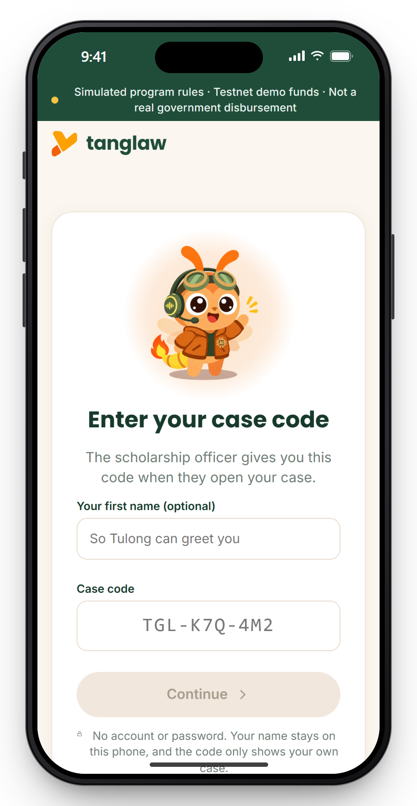
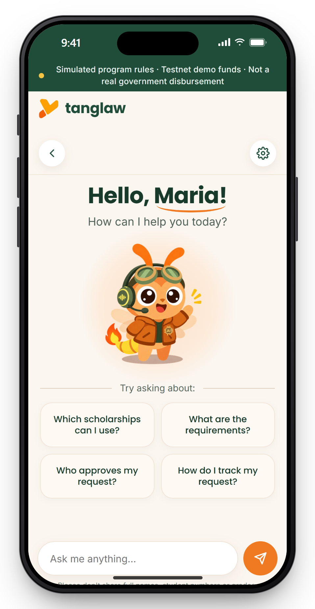
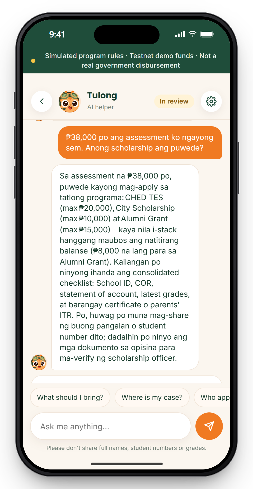
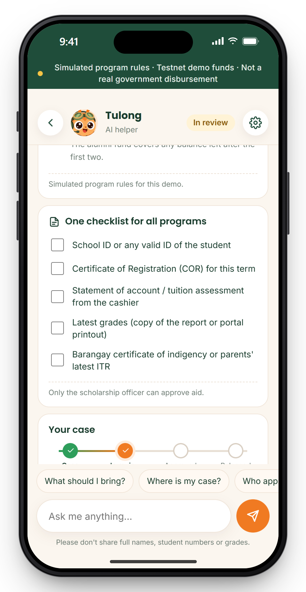
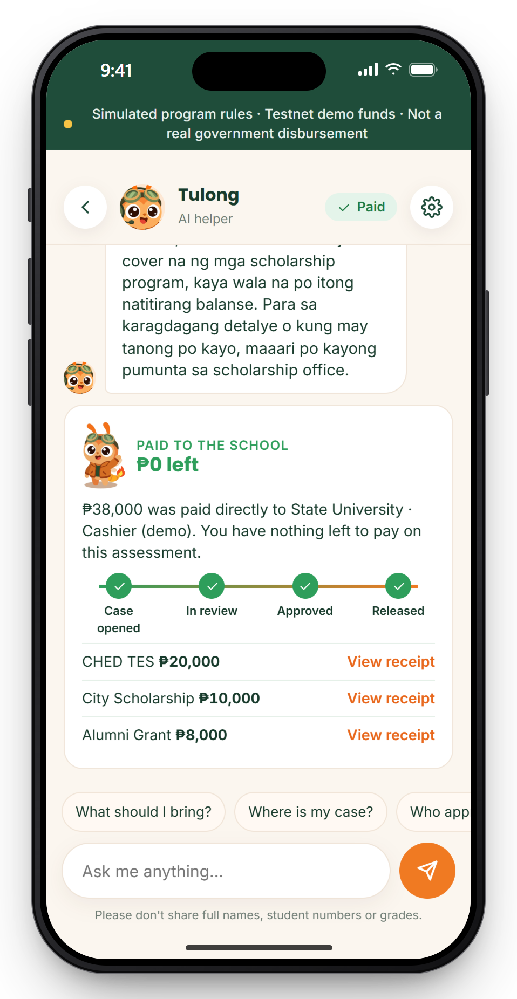
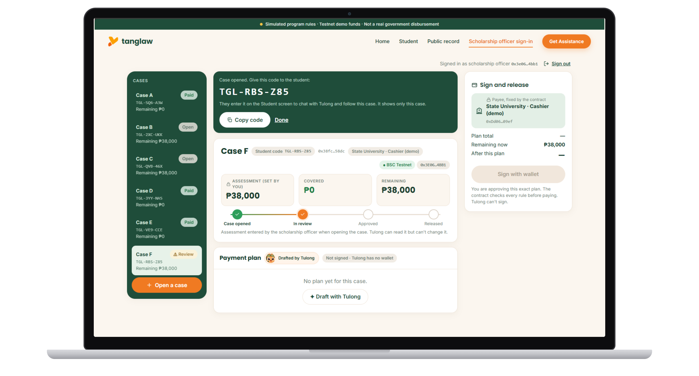
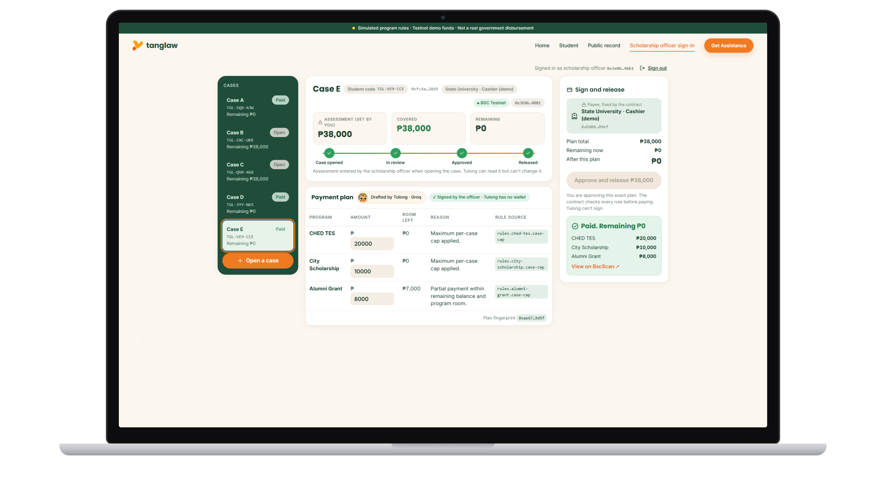
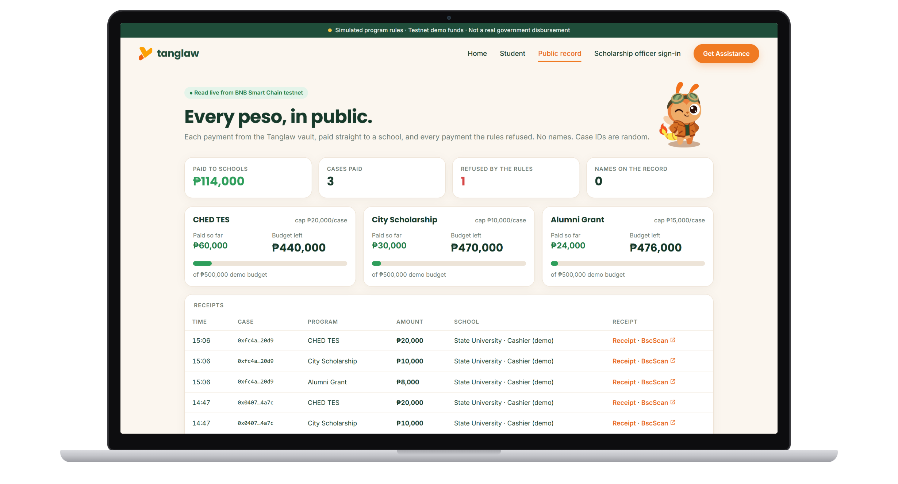
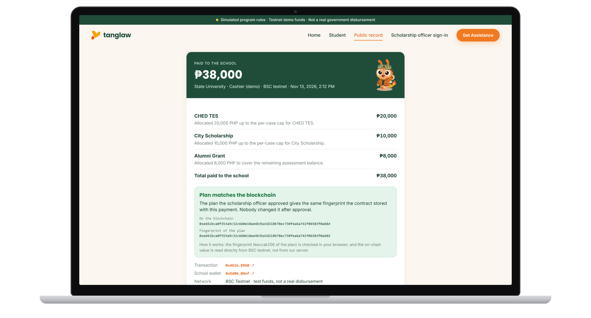
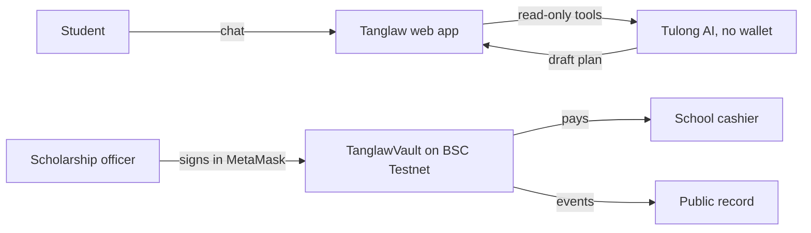

# Tanglaw

**Liwanag sa bawat piso** (light on every peso). Scholarships paid by the rules, straight to the school.

One student often holds several scholarships at once (CHED TES, a city scholarship, an alumni grant). Each office pays separately, nobody sees the whole picture, and that is how double-funding and ghost scholars happen. In Tanglaw, an AI assistant explains the programs and drafts a fair split, a scholarship officer signs, and a smart contract on BNB Smart Chain enforces every cap and pays only the school. Every payment and refusal is public, with no names.

> Runs on BSC Testnet (chain 97) with testnet funds only. Program rules are simulated. Started at BCC Hackathon 2026 (University of Makati x Binance Academy).

## How it works

1. **The student asks Tulong.** Maria enters the case code from the scholarship office and chats with Tulong, the AI assistant, in Taglish. Tulong explains which programs fit and gives one combined document checklist.
2. **Tulong drafts a plan.** It fills programs within each cap (CHED TES ₱20,000 + City ₱10,000 + Alumni ₱8,000 = ₱38,000), with a reason and rule source per line. Tulong has no wallet and cannot pay anyone.
3. **The officer signs.** The scholarship officer checks the documents, reviews the plan and signs once in MetaMask.
4. **The contract pays the school.** TanglawVault refuses anything over a program's cap, its budget or the assessment, and pays only the school registered for the case.

**The prompt is a suggestion; the contract is the law.** If anyone raises a line so the total passes the assessment, the contract refuses it on-chain with `OverBill`.

## Screenshots

**Student app.** No account, no wallet, no crypto words. Tulong's replies are real output.

<table>
  <tr>
    <td align="center" width="20%"><br><sub><b>Enter the case code</b></sub></td>
    <td align="center" width="20%"><br><sub><b>Meet Tulong</b></sub></td>
    <td align="center" width="20%"><br><sub><b>Ask in Taglish</b></sub></td>
    <td align="center" width="20%"><br><sub><b>One checklist</b></sub></td>
    <td align="center" width="20%"><br><sub><b>Paid to the school</b></sub></td>
  </tr>
</table>

**Scholarship officer and public record.**

<table>
  <tr>
    <td align="center" width="50%"><br><sub><b>Open a case</b><br>The officer sets the assessment and gives the student a code</sub></td>
    <td align="center" width="50%"><br><sub><b>Sign and pay</b><br>Tulong's plan, one signature, paid to the school</sub></td>
  </tr>
  <tr>
    <td align="center" width="50%"><br><sub><b>Public record</b><br>Every payment and refusal, budgets left, no names</sub></td>
    <td align="center" width="50%"><br><sub><b>Receipt</b><br>The approved plan matches the fingerprint on-chain</sub></td>
  </tr>
</table>

## Architecture



| Part | Technology |
|---|---|
| Contract | Solidity 0.8.24, Foundry, OpenZeppelin 5. 14 tests passing |
| Web app | Next.js 16, React 19, wagmi, viem, TypeScript |
| AI | Gemini first, Groq as fallback, server-side only |

**Contract.** `openCase` (officer types the assessment) and `approveAndPay` (checks cap, budget and assessment, then pays the case's school). No function accepts a recipient address. On-chain data is only random case IDs, salted hashes, amounts and statuses.

**Tulong.** Read-only tools plus one `draft_payment_plan` output, validated in code before anyone sees it. It treats memos as data, so a hidden "send everything to 0x..." instruction is flagged, not followed. The approved plan's hash is stored on-chain with each payment.

More detail in [`ARCHITECTURE.md`](ARCHITECTURE.md) and [`MIGRATION.md`](MIGRATION.md).

## Run it locally

Requires Node.js, [Foundry](https://book.getfoundry.sh/getting-started/installation) and MetaMask on BSC Testnet.

```bash
cd contracts && npm install && forge test
```

Copy `.env.example` to `.env` and fill in `GEMINI_API_KEY`, `GROQ_API_KEY` and `SESSION_SECRET`. Then:

```bash
cd web && npm install && npm run dev
```

Open http://localhost:3000. To deploy your own vault, see [`contracts/README.md`](contracts/README.md).

## Limitations

- Simulated program rules and testnet funds only.
- The assessment's authenticity rests on the officer.
- Off-chain data is a local JSON file; hosting needs a database first.

## AI disclosure

Tulong runs on Gemini with Groq as fallback. It has no wallet and cannot sign. AI coding assistants helped write code and docs; the author reviewed, tested and deployed the result.

## License

[MIT](LICENSE)
